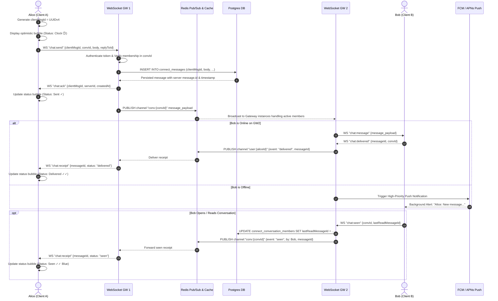

# BRG Connect — Enterprise Communication & Real-time Collaboration Engine
### Technical Architecture, Data Models, Protocols & Implementation Specification

> **System Purpose:** BRG Connect is the integrated, enterprise-grade real-time messaging, audio/video calling, and workflow collaboration module for the BridgeOne ERP platform. It directly connects employees, departments, and cross-functional teams with direct chats, channels, ERP record embedding, and WebRTC calls without third-party SaaS dependencies.

---

## 1. System Overview & Component Topology

```
+---------------------------------------------------------------------------------------+
|                                    CLIENT TIER                                        |
|  Next.js 16 (App Router) + React 19 Web App  |  Flutter / React Native Mobile Client  |
+---------------------------------------------------------------------------------------+
          |                                                               |
    REST / HTTPS API                                               Secure WebSocket (WSS)
    (Auth, History, Uploads)                                       (Realtime Messaging,
          |                                                         Signaling, Presence)
          v                                                               |
+-------------------------------+                         +-----------------------------+
|        REST API SERVER        |                         |      WEBSOCKET GATEWAY      |
|  (Next.js App / Node.js API)  |                         |    (Node.js / Socket.IO /    |
|   • JWT & Session Validate    |                         |        Fastify uWebSockets) |
|   • Conversations & Members   |                         |   • Realtime message fanout |
|   • Message History & Search  |                         |   • Typing & seen receipts  |
|   • Pre-signed S3/MinIO URLs  |                         |   • WebRTC call signaling   |
+-------------------------------+                         +-----------------------------+
          |            |                                                 |
          |            +------------------+------------------------------+
          |                               |
          v                               v
+-------------------------------+  +-----------------------------+  +--------------------------+
|       PRIMARY DATABASE        |  |        REDIS CLUSTER        |  |    S3 / MINIO STORAGE    |
|      (PostgreSQL 16+)         |  |      (Pub/Sub & Cache)      |  |   (Object Store Engine)  |
|   • Direct & Group Threads    |  |   • Message fanout pub/sub  |  |   • Encrypted at rest    |
|   • Messages & Attachments    |  |   • Presence & Online sets  |  |   • Client direct PUT    |
|   • ERP Employees & Members   |  |   • Ephemeral typing states |  |   • ClamAV virus scanner |
|   • Call Logs & Participants  |  |   • Rate limit sliding logs |  |   • Pre-signed GET urls  |
+-------------------------------+  +-----------------------------+  +--------------------------+
                                                  |
                                                  v
                                   +-----------------------------+
                                   |       WEBRTC CALL TIER      |
                                   |   • 1-to-1: Coturn (STUN/TURN)
                                   |   • Group: LiveKit SFU      |
                                   |   • Push: FCM / APNs        |
                                   +-----------------------------+
```

---

## 2. Component Breakdown & Responsibilities

| Component | Responsibility | Tech Choice | Why this choice |
|---|---|---|---|
| **REST API** | Auth validation, pagination history sync, thread creation, membership, pre-signed upload tickets | Next.js 16 Route Handlers / Fastify | Unified auth with ERP JWT, typed Zod validation |
| **WebSocket Gateway** | Full-duplex messaging, presence broadcast, seen/delivery receipts, WebRTC SDP/ICE exchange | Node.js + Socket.IO (or `uWebSockets.js`) | Avoids polling latency; native event multiplexing |
| **Redis Engine** | Cross-instance pub/sub, heartbeat presence hashes, unread counters, distributed mutex | Redis 7+ Cluster / Valkey | Sub-millisecond pub/sub broadcast across gateway pods |
| **Object Storage** | Attachments, images, audio notes, generated exports | MinIO (Self-hosted) or AWS S3 | DB stays lean; clients upload directly via pre-signed PUT |
| **WebRTC 1-to-1** | P2P audio/video calls with encrypted media streams | WebRTC + Coturn (STUN/TURN) | Mandatory for corporate firewalls, NATs, and mobile data |
| **Group Calls & SFU** | Multi-party audio/video, screen sharing, recording | LiveKit SFU (Self-hosted) | Open source, battle-tested Go SFU with Web & Flutter SDKs |
| **Push Notifications**| Background wakeups, call alerts, missed messages | FCM (Android) + APNs (iOS) | High priority data payloads with CallKit/ConnectionService |

---

## 3. Database Schema Specification (PostgreSQL / Prisma)

### 3.1 Design Principles
1. **Reuse Existing ERP Entities**: The `users` and `employees` tables in the ERP are referenced directly. No duplicate employee records.
2. **Lean Read Receipts**: Instead of storing a receipt row per user per message (which explodes to millions of rows), each member has a single `last_read_message_id`. Unread count is a single index scan `COUNT(*) WHERE id > last_read_message_id`.
3. **Client Message ID (`client_msg_id`)**: Generated by the client (UUID v4) to provide strict idempotency and duplicate prevention over unstable networks.
4. **Soft Deletion & Time Window**: Message edit and delete operations have a 15-minute grace window and maintain audit integrity (`edited_at`, `deleted_at`).

### 3.2 Prisma Schema Definition

```prisma
enum ConnectConversationType {
  DIRECT
  GROUP
}

enum ConnectMemberRole {
  ADMIN
  MEMBER
}

enum ConnectMessageType {
  TEXT
  FILE
  IMAGE
  SYSTEM
  ERP_CARD
  CALL
}

enum ConnectCallType {
  AUDIO
  VIDEO
}

enum ConnectCallStatus {
  RINGING
  ONGOING
  COMPLETED
  MISSED
  REJECTED
}

/// Conversation channel or 1-to-1 direct chat thread
model ConnectConversation {
  id          String                  @id @default(uuid()) @db.Uuid
  type        ConnectConversationType @default(DIRECT)
  name        String?                 @db.VarChar(150)
  description String?                 @db.VarChar(500)
  avatarUrl   String?                 @db.VarChar(500)
  isArchived  Boolean                 @default(false)
  createdById String?                 @db.Uuid
  createdAt   DateTime                @default(now()) @db.Timestamptz(3)
  updatedAt   DateTime                @updatedAt @db.Timestamptz(3)

  members     ConnectConversationMember[]
  messages    ConnectMessage[]
  calls       ConnectCall[]

  @@map("connect_conversations")
}

/// Member participating in a conversation thread
model ConnectConversationMember {
  id                String            @id @default(uuid()) @db.Uuid
  conversationId    String            @db.Uuid
  userId            String            @db.Uuid
  employeeId        String?           @db.Uuid
  role              ConnectMemberRole @default(MEMBER)
  lastReadMessageId String?           @db.Uuid
  isMuted           Boolean           @default(false)
  mutedUntil        DateTime?         @db.Timestamptz(3)
  joinedAt          DateTime          @default(now()) @db.Timestamptz(3)
  leftAt            DateTime?         @db.Timestamptz(3)

  conversation      ConnectConversation @relation(fields: [conversationId], references: [id], onDelete: Cascade)
  user              User                @relation(fields: [userId], references: [id], onDelete: Restrict)
  employee          Employee?           @relation(fields: [employeeId], references: [id], onDelete: SetNull)

  @@unique([conversationId, userId])
  @@index([userId, isMuted])
  @@index([conversationId, role])
  @@map("connect_conversation_members")
}

/// Real-time chat message record
model ConnectMessage {
  id             String             @id @default(uuid()) @db.Uuid
  conversationId String             @db.Uuid
  senderId       String             @db.Uuid
  clientMsgId    String?            @db.VarChar(64)
  type           ConnectMessageType @default(TEXT)
  body           String             @db.Text
  replyToId      String?            @db.Uuid
  
  // Embedded ERP Entity (PO, Requisition, Invoice, Item)
  erpRecordType  String?            @db.VarChar(50)
  erpRecordId    String?            @db.VarChar(100)
  erpRecordData  Json?

  editedAt       DateTime?          @db.Timestamptz(3)
  deletedAt      DateTime?          @db.Timestamptz(3)
  createdAt      DateTime           @default(now()) @db.Timestamptz(3)

  conversation   ConnectConversation  @relation(fields: [conversationId], references: [id], onDelete: Cascade)
  sender         User                 @relation(fields: [senderId], references: [id], onDelete: Restrict)
  replyTo        ConnectMessage?      @relation("ConnectMessageReplies", fields: [replyToId], references: [id], onDelete: SetNull)
  replies        ConnectMessage[]     @relation("ConnectMessageReplies")
  attachments    ConnectAttachment[]

  @@index([conversationId, createdAt(sort: Desc)])
  @@index([clientMsgId])
  @@index([senderId])
  @@map("connect_messages")
}

/// Files, images, and audio attachments stored in S3/MinIO
model ConnectAttachment {
  id         String   @id @default(uuid()) @db.Uuid
  messageId  String   @db.Uuid
  fileKey    String   @db.VarChar(500)
  fileName   String   @db.VarChar(255)
  mimeType   String   @db.VarChar(100)
  sizeBytes  Int
  cdnUrl     String   @db.VarChar(1000)
  createdAt  DateTime @default(now()) @db.Timestamptz(3)

  message    ConnectMessage @relation(fields: [messageId], references: [id], onDelete: Cascade)

  @@index([messageId])
  @@map("connect_attachments")
}

/// WebRTC Audio/Video call records
model ConnectCall {
  id             String            @id @default(uuid()) @db.Uuid
  conversationId String            @db.Uuid
  startedById    String            @db.Uuid
  type           ConnectCallType   @default(AUDIO)
  status         ConnectCallStatus @default(RINGING)
  startedAt      DateTime          @default(now()) @db.Timestamptz(3)
  endedAt        DateTime?         @db.Timestamptz(3)
  durationSec    Int               @default(0)

  conversation   ConnectConversation      @relation(fields: [conversationId], references: [id], onDelete: Cascade)
  startedBy      User                     @relation(fields: [startedById], references: [id], onDelete: Restrict)
  participants   ConnectCallParticipant[]

  @@index([conversationId, startedAt(sort: Desc)])
  @@map("connect_calls")
}

/// WebRTC Call participant joins and leaves
model ConnectCallParticipant {
  id       String    @id @default(uuid()) @db.Uuid
  callId   String    @db.Uuid
  userId   String    @db.Uuid
  joinedAt DateTime  @default(now()) @db.Timestamptz(3)
  leftAt   DateTime? @db.Timestamptz(3)

  call     ConnectCall @relation(fields: [callId], references: [id], onDelete: Cascade)
  user     User        @relation(fields: [userId], references: [id], onDelete: Restrict)

  @@unique([callId, userId])
  @@index([userId])
  @@map("connect_call_participants")
}
```

---

## 4. Message Delivery Lifecycle (Step-by-Step)



---

## 5. WebRTC Calling Architecture

### 5.1 1-to-1 Calls (Peer-to-Peer with Coturn)
1. **Signaling Handshake via WebSocket**:
   - `call:invite` (Caller -> Server -> Recipient)
   - `call:ringing` (Recipient -> Server -> Caller)
   - `call:accept` (Recipient accepts, initializes `RTCPeerConnection`)
   - `call:offer` / `call:answer` (SDP session exchange)
   - `call:ice-candidate` (Trickle ICE network routing discovery)
2. **Coturn Configuration**:
   - STUN runs on port `3478` (UDP/TCP).
   - TURN runs on port `5349` (TLS) and port `443` (TCP fallback for restrictive corporate outbound firewalls).
   - Ephemeral credentials generated using HMAC-SHA1 shared secret (`turn:<timestamp>:<username>`).

### 5.2 Group Calls (SFU Architecture via LiveKit)
- Peer-to-peer mesh does not scale past 3–4 participants ($N \times (N-1)$ connections).
- Self-hosted LiveKit SFU (Selective Forwarding Unit) receives 1 upstream stream per user and forwards it downstream to other room participants.
- Server validates participant identity via LiveKit room access tokens signed with API secret.

---

## 6. Realtime WebSocket Events Protocol Reference

| Event Name | Direction | Payload Parameters | Purpose |
|---|---|---|---|
| `auth` | Client ➜ Server | `{ token: string }` | Authenticates socket connection with ERP JWT |
| `presence:heartbeat` | Client ➜ Server | `{ status: "online" \| "away" }` | 30s keep-alive; updates Redis key TTL |
| `presence:update` | Server ➜ Client | `{ userId, status, lastSeen }` | Broadcasts colleague presence changes |
| `chat:send` | Client ➜ Server | `{ clientMsgId, convId, body, type, erpRecord }` | Sends new chat message |
| `chat:ack` | Server ➜ Client | `{ clientMsgId, messageId, createdAt }` | Server receipt confirmation (Sent ✓) |
| `chat:message` | Server ➜ Client | `{ message: ConnectMessage }` | Inbound message dispatched to active members |
| `chat:delivered` | Client ➜ Server | `{ messageId, convId }` | Acknowledges receipt on recipient device |
| `chat:seen` | Client ➜ Server | `{ convId, lastReadMessageId }` | Marks conversation as read up to messageId |
| `chat:receipt` | Server ➜ Client | `{ messageId, status: "delivered" \| "seen" }`| Broadcasts delivery / seen status |
| `chat:typing` | Client ➜ Server | `{ convId, isTyping: boolean }` | Ephemeral typing indicator (debounced 2s) |
| `call:invite` | Client ➜ Server | `{ convId, callType: "audio" \| "video" }` | Initiates new call |
| `call:signal` | Bidirectional | `{ callId, sdp?, candidate?, type }` | WebRTC session & candidate exchange |
| `call:end` | Bidirectional | `{ callId, reason }` | Hangs up and writes duration to database |

---

## 7. Security, Compliance & Governance Controls

1. **Authentication & Session Tokens**:
   - WebSocket handshakes require valid ERP bearer tokens or signed session cookies.
   - Sockets authenticate on connect and re-validate permissions against tenant roles on every room join.
2. **Access Control & Enterprise Offboarding**:
   - When an employee is deactivated in the ERP (`Employee.status = "Inactive"` or `User.isActive = false`), a Redis invalidation hook disconnects all active sockets for that user.
   - The user cannot establish new connections or read unread messages, but prior messages remain for legal and compliance audit trails.
3. **Data Protection (At Rest & In Transit)**:
   - All network transit is enforced over TLS 1.3 / WSS.
   - S3/MinIO buckets use AES-256 server-side encryption.
   - No disappearing messages to ensure regulatory audit compliance in accounting and procurement disputes.
4. **Attachment Security**:
   - File uploads bypass database storage entirely.
   - Client requests pre-signed PUT URL with content type and size limits (e.g., 25 MB max per file).
   - Async background webhook runs ClamAV scanner on new S3 keys before CDN distribution.

---

## 8. Implementation Roadmap

- **Phase 1 (Current Active Scope)**:
  - Direct 1-to-1 chats and multi-member team channels.
  - Real-time messaging with Sent (✓), Delivered (✓✓), and Seen (✓✓ blue) states.
  - Typing indicators, online/away presence status.
  - File, image, and document upload simulation with preview and download.
  - Message replies, copy, edit (15-min limit), and delete.
  - Unread badge counters, mute toggles, and message search.
  - Integrated ERP Employee Directory lookup (by name, department, role, phone).
  - Embedded ERP record sharing (PO, Requisition, Sales Invoice cards).
- **Phase 2**:
  - Live WebRTC 1-to-1 Audio & Video calling with Coturn STUN/TURN integration.
  - Voice audio messaging (recorded push-to-talk).
  - Department automatic auto-enrollment channels.
- **Phase 3**:
  - LiveKit SFU group video meetings and screen sharing.
  - Interactive actionable chat cards (1-click Approve / Reject for Leave, POs, and Requisitions).
  - System bot event webhooks and audit compliance export dashboards.
